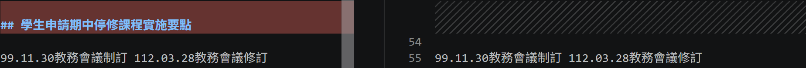
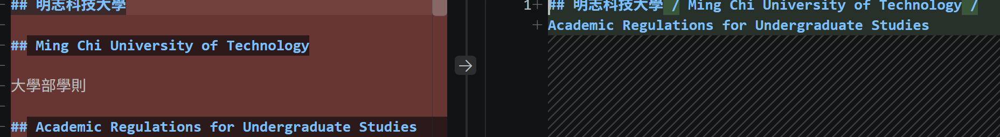
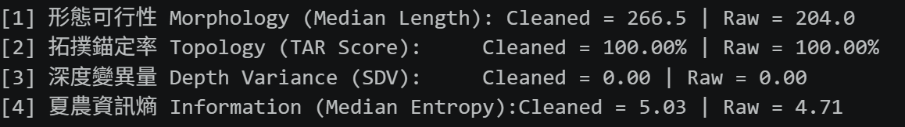

# 資料前處理報告 (Data Preparation Report)

> 期中評量 · NLP 自然語言處理 115-S1
> 填寫方式：請把所有「（ ）」與 `___` 替換成你自己的內容，並刪除 `>` 開頭的說明文字。

- **學號 / 姓名**：_U12627022 / 陳心如__
- **專案名稱**：_NLP 自然語言處理 (115 S1) - 課程專案__
- **完成的任務**：- [ x] 1-A 頁首頁尾清除　- [ x] 1-B 雙語標題合併　- [ x] 1-C 雙語條文合併

---

## 1. 資料集概覽 (Dataset Overview)

> 數字來源：`01_Data_Ingestion.ipynb` 第 2 節 (掃描 PDF) 與第 5 節 (批次處理) 的輸出。

| 類別 (Cluster) | PDF 數量 | 清洗前 chunk 數 | 清洗後 chunk 數 |
|---|---|---|---|
| Academic_Affairs| 3| 96|67 |
| Library_Information|3 | 248| 228|
|Student_Affairs| 3|66 | 55|
| **合計** |9 |410 | 350|

**問題 (2–3 句)：** 清洗後 chunk 數量變少了多少？是哪個任務造成的？有沒有哪個任務**不影響** chunk 數量？為什麼？

清洗前共有 410 個 chunk，清洗後剩下 350 個 chunk，總共減少 60 個 chunk。主要是因為 1-B 將原本分開的中文標題與英文標題合併，減少了部分標題切分邊界。1-A 主要是清除多餘的頁首頁尾文字，1-C 則是合併中英文條文內容，兩者都不是以 Markdown 標題作為切分邊界，因此不會直接造成 chunk 數量減少。

___

## 2. 清洗步驟 (Cleaning Steps)

> **截圖來源：** `data/interim/<類別>/` 中的 `raw_*.md` (清洗前) 與 `cleaned_*.md` (清洗後)，也就是批次處理存下的**真實檔案**。
>
> **[重要] 不可使用 notebook 中的範例。** notebook 任務 1-A、1-B、1-C 的測試文字 (第二十一條、明志科技大學 / Ming Chi University of Technology、第十五條 / Article 15) **不能**作為你的截圖。請在真實檔案中**另找一處**，可以是其他 PDF 的檔案。使用範例的截圖**不給分**。
>
> **截圖方法 (VS Code 比較檢視)：**
> 1. 在檔案總管對 `raw_<檔名>.md` 按右鍵 → **Select for Compare**。
> 2. 對同一份文件的 `cleaned_<檔名>.md` 按右鍵 → **Compare with Selected**。
> 3. 左右並排顯示，紅色 = 刪除，綠色 = 新增或修改。按 `Ctrl + F` 搜尋，找到該任務造成的變更。
> 4. 每個任務截**一張**圖，存到 `reports/figures/`，**檔名必須完全相同** (否則圖片不會顯示)：
>    * 任務 1-A → `1a_compare.png`
>    * 任務 1-B → `1b_compare.png`
>    * 任務 1-C → `1c_compare.png`

### 2.1 任務 1-A：頁首頁尾溢出清除

- 檔名：__A231060004_學生申請期中停修課程實施要點_　搜尋的文字：__學生申請期中停修課程實施要點_
- 截圖 (存為 `reports/figures/1a_compare.png`)：
- 改變了什麼：_清洗前的文件內容中，出現了多餘的法規名稱，可能是 PDF 頁首頁尾溢出的文字。經過 1-A 處理後，程式會根據 PDF 檔名取得法規名稱，並清除符合條件的多餘標題文字。__
- 這對之後的問答檢索有什麼幫助：_可以減少不必要的重複文字，避免系統檢索時將頁首頁尾誤認為重要內容，提高資料的整潔度。__
- 這個任務有沒有**改錯**的地方 (把不該改的也改了)？若有，寫出檔名與搜尋的文字；若沒有，寫「沒有發現」：__有，學生申請期中停修課程實施要點，在最前面的標題也刪掉了_

### 2.2 任務 1-B：雙語標題合併

- - 檔名：__A232020018_大學部學則_　搜尋的文字：__明志科技大學/Ming Chi University of Technology_
- 截圖 (存為 `reports/figures/1b_compare.png`)：
- 改變了什麼：__將原本分開的中文標題與英文標題合併在同一行，中間使用「 / 」隔開，讓中英文標題能夠對應在一起。_
- 這對之後的問答檢索有什麼幫助：_可以讓系統同時辨識中文和英文標題，減少中英文標題分開造成的資訊斷裂，讓後續搜尋更容易找到相對應的內容。__
- 這個任務有沒有**改錯**的地方 (把不該改的也改了)？若有，寫出檔名與搜尋的文字；若沒有，寫「沒有發現」：_沒有發現__

### 2.3 任務 1-C：雙語條文合併

- 檔名：__A232060013_學生抵免學分辦法_　搜尋的文字：_## 明志科技大學## Ming Chi University of Technology__
- 截圖 (存為 `reports/figures/1c_compare.png`)：
- 改變了什麼：_將原本分開的中文條文與英文翻譯合併在一起，中間使用「 / 」隔開，並保留原本條文中的其他段落內容。__
- 這對之後的問答檢索有什麼幫助：_當使用者以中文或英文搜尋同一條規定時，可以讓系統取得較完整的雙語條文內容，減少語言不同造成的檢索困難。__
- 這個任務有沒有**改錯**的地方 (把不該改的也改了)？若有，寫出檔名與搜尋的文字；若沒有，寫「沒有發現」：__沒有發現_

## 3. 評估指標與 AI 解讀查證 (Metrics & Verifying the AI's Interpretation)

### 3.1 指標數據表

> 數字來源：專案根目錄的 `metrics.json`。[1]、[2] 必填；[3]、[4] 選填。
> 「參考值」由老師在課堂上公布 (完成全部任務的結果)。

| 指標 | Raw | Cleaned (你的) | Cleaned (參考值) |
|---|---|---|---|
| [1] 中位數長度 Median Length |204 |266.5 |270.5 |
| [2] 拓撲錨定率 TAR |100%	 | 100%	| 100%|
| [3] 深度變異量 SDV (選填) |0 | 0| 0|
| [4] 中位數資訊熵 Entropy (選填) |4.71	|5.03| 5.06|

> **儀表板截圖：** 你自己的 `01_Data_Ingestion.ipynb` **第 6 節**輸出的 4 拼圖儀表板 (第 8 週執行並保留的輸出)。截圖後存為 `reports/figures/dashboard.png`。第 3.2 節也會用到這張截圖。



你的 Cleaned 結果與參考值一致嗎？若一致，寫「一致」；若不一致，找出原因。（1 句）

___不完全一致，可能是因為資料清洗過程中，部分文字的合併、刪除及 Markdown 標題切分結果略有不同，造成 chunk 的長度與文字內容有所差異，因此 Median Length 和 Entropy 與老師的參考值有些微差距。不過，TAR 和 SDV 的結果與老師相同，整體評估結果仍相當接近。

### 3.2 AI 的解讀

> 把第 3.1 節的儀表板截圖 (`dashboard.png`) 交給 AI，請它解讀結果。將 AI 的回答**完整貼在這裡**，並註明使用的 AI 工具。

- 使用的 AI 工具：_chatgpt__

根據資料前處理評估儀表板，可以比較 Raw（清洗前）與 Cleaned（清洗後）在四項指標上的差異。

Median Length（中位數長度）

Median Length 是指所有 chunk 文字長度的中位數，可以用來觀察每個 chunk 的內容長度。Raw 的數值為 204.0，Cleaned 增加至 266.5，表示清洗後 chunk 的中位數長度增加。這可能是因為資料清洗時合併了原本分開的中英文標題或條文，使部分 chunk 包含較完整的內容。對後續問答檢索而言，較完整的 chunk 有助於保留上下文，降低重要資訊被分散的情況；但如果 chunk 太長，也可能包含過多不相關資訊，影響檢索的精確度。

TAR（拓撲錨定率）

TAR 是用來評估資料清洗後，原本的文件結構與標題錨點是否有被保留。Raw 和 Cleaned 的數值皆為 100%，表示清洗前後的拓撲錨定率沒有改變，原有的結構錨點都能被保留。這對後續問答檢索有幫助，因為系統可以利用標題及文件結構定位相關內容，讓搜尋結果更容易對應到正確的法規或條文。

SDV（深度變異量）

SDV 用來觀察資料結構深度的變化程度。Raw 和 Cleaned 的數值皆為 0.00，表示依照本次評估指標的計算結果，清洗前後沒有觀察到深度變異。這代表資料清洗沒有造成此項結構深度指標的變化，有助於維持文件原有的結構層次，讓後續檢索能夠依照文件結構取得相關內容。

Entropy（中位數資訊熵）

Entropy 是用來觀察文字內容的資訊多樣性。Raw 的數值為 4.71，Cleaned 增加至 5.03，表示清洗後的文字資訊熵略有提升，代表文字內容的資訊分布有所變化。這可能與清除多餘文字，以及合併中英文標題和條文有關。對後續問答檢索而言，適當的資訊多樣性有助於保留更多有效內容，但資訊熵增加不代表檢索品質一定提高，仍需要搭配實際檢索結果進行確認。

整體分析：

整體而言，資料清洗後的 Median Length 從 204.0 增加至 266.5，Entropy 從 4.71 增加至 5.03，而 TAR 和 SDV 則維持不變。這表示清洗後的 chunk 中位數長度增加，文字資訊分布也有所變化，同時維持了原有的拓撲錨定率與深度變異量。整體結果顯示本次資料前處理在保留文件結構的同時，也改善了部分文字內容的完整性，對後續 NLP 問答檢索具有正面幫助。不過，仍需要透過實際檢索測試，才能進一步確認清洗後的資料品質是否提升。
```

### 3.3 你的查證 (至少兩點)

> 挑 AI 說得最肯定的兩句話，回到你的檔案或程式中找證據：它說的是真的嗎？

**查證 1**
- AI 的說法：_Cleaned 的 Median Length 比 Raw 高__
- 我查了什麼 (哪個檔案、哪個 chunk、哪段程式)：__查看 metrics.json 中 Median Length 的數值，以及 Notebook 第 6 節的評估結果。_
- 結論：正確 / 部分正確 / 錯誤，因為 __部分正確，因為 Cleaned 的中位數長度為 266.5，高於 Raw 的 204.0，表示清洗後 chunk 的中位數長度增加，但中位數不代表平均值。_

**查證 2**
- AI 的說法：_Raw 與 Cleaned 的 TAR 都是 100%，表示清洗前後的拓撲錨定率沒有改變。__
- 我查了什麼：_查看 Notebook 第 6 節的 TAR 計算結果，以及 metrics.json__
- 結論：正確 / 部分正確 / 錯誤，因為 _正確，因為 Raw 和 Cleaned 的 TAR 都是 100%，代表兩者在此項指標上的結果相同。__

### 3.4 實際證據：你被指定的 chunk

> 執行 `09_midterm_chunks.ipynb`：填入你的學號與老師在課堂上公布的 SEED，按 Run All。
> 每位同學拿到的 chunk 不同。請**連同驗證碼**一起填入。
> 程式只顯示前 400 字元的預覽。請在 VS Code 打開程式列出的**閱讀用檔案** (`data/interim/` 中的 `cleaned_*.md`，與 JSON 內容相同但有正常換行)，按 `Ctrl + G` 輸入程式給的**行號** (或按 `Ctrl + F` 搜尋「搜尋用」文字)，從該行讀到下一個 `## ` 標題為止，就是**完整**的 chunk。

- **SEED**：_1106__

**(a) 很長的 chunk**
- 資料檔 (JSON)：__A232060013_學生抵免學分辦法_　位置：第 __29 個 _  (從 0 開始數)　長度：_9411__ 字元　驗證碼：_57e784b1__
- 閱讀用檔案 (`.md`)：__A232060013_學生抵免學分辦法_　從第 __317_ 行開始
- 前 3 行內容：
  ```text
## 學年度第 學期

| 系所(學 位學程)      |                      |                      |                      | 班級                 |                      |                      |                      | 學號                                                                                                                                                                                       |                                                                                                                                                                                            |                                                                                                                                                                                            |                                                                                                                                                                                            | 姓名                 | 姓名                 | 姓名                 |
  ```
- 這是什麼樣的文字？為什麼會這麼長？_這個 chunk 主要是學生學分抵免相關的申請表格及參考資料，包含學生基本資料、原應修習科目、實際修習科目、核簽流程，以及國外學校學分與成績轉換參考表。因為文件中包含大量表格，而且部分表格欄位很多、內容較長，Markdown 切塊時沒有將這些內容進一步拆分，因此形成長達 9411 字元的 chunk。__
- 之後做問答檢索時，這麼長的 chunk 可能造成什麼問題？__過長的 chunk 可能同時包含太多不同類型的資訊，例如申請表格、核簽流程及學分轉換標準，使各項內容混在一起。當使用者搜尋特定問題時，系統可能難以精確找到需要的資訊，也可能取回許多不相關的內容，降低檢索的精確度。此外，過長的內容也可能增加模型閱讀與處理資料的負擔。_

**(b) 資訊熵很低的 chunk**
- 資料檔 (JSON)：_A242060013_學生請假作業辦法__　位置：第 _3 __ 個 (從 0 開始數)　資訊熵：_2.83__　驗證碼：__c3940e3f_
- 閱讀用檔案 (`.md`)：__A242060013_學生請假作業辦法.md_　從第 __79_ 行開始
- 內容：
  ```text
 ## Table of Contents

|           |                                                 |   頁次 |
  ```
- 為什麼它的資訊熵這麼低？它對問答檢索有用嗎？__這個 chunk 的資訊熵較低，可能是因為內容較簡短，使用的文字和詞彙比較固定，主要是在說明學生必須透過線上請假系統辦理請假，文字變化較少，因此資訊熵只有 2.83。這個 chunk 對問答檢索仍然有用，因為它包含明確的請假方式，當使用者詢問如何辦理請假時，系統可以利用這段內容回答。不過，由於內容較少，能回答的問題範圍也比較有限。_

## 4. 一個尚未解決的問題 (One Remaining Problem)

> 打開 `data/interim/` 中任一個 `cleaned_*.md` (與 `data/processed/` 的 JSON 內容相同，但有正常換行，比較好讀)，找出一個清洗後**仍然有問題**的 chunk。
> 每個 chunk 從一個 `## ` 標題開始，到下一個 `## ` 標題之前結束。
> 例如：只有標題沒有內文、表格亂掉、中英文沒有對齊、還有殘留的頁首頁尾、斷行造成的多餘空白，或是**清洗造成的錯誤** (誤合併、誤刪除)。
> **不可**使用第 3.4 節的兩個 chunk。

- **檔名** (`cleaned_*.md`)：___　**從第 ___ 行開始** (VS Code 左側的行號)　**標題**：___
- **我是怎麼找到的** (例如：搜尋了什麼、看了哪個檔案)：___
- **問題 chunk (貼上部分內容)**：

```text
## Table of Contents

|           |                                                 |   頁次 |
```

- **問題是什麼**：___
- **可能的原因** (PDF 本身？Docling 轉換？清洗的正則表示式？切塊規則？)：___
- **具體的修正方法** (例如：一條規則、一個正則表示式的構想、長度上限)：___
- **對問答檢索的影響**：___

## 5. AI 協作 (AI Collaboration)

- 本次作業的 AI 協作紀錄請見 [`AI_USAGE.md`](AI_USAGE.md) 的「Week 04 / 08」與「Week 09」段落。
- 這次使用 AI 最大的收穫或教訓是 _本次作業使用 AI 協助設計資料清洗的正則表示式，以及檢查程式執行時遇到的問題。我認為提示詞中明確說明清洗條件和需要保留的內容非常重要，這樣可以減少 AI 產生不符合需求的程式碼。不過，AI 提供的結果不一定完全正確，例如 1-A 可能將原本應該保留的法規標題也刪除，因此仍然需要透過 Assertion、Raw 與 Cleaned 檔案比較，以及實際資料檢查來確認結果。這次作業讓我了解 AI 可以協助資料前處理，但最後仍需要自己驗證資料是否正確。__（請具體：例如提示詞中哪一段最關鍵、AI 哪一句解讀不正確）
